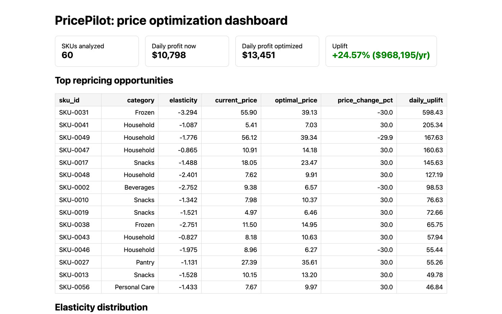

# PricePilot

[](https://github.com/otawfik/pricepilot/actions/workflows/ci.yml)

**End-to-end retail price optimization: estimate demand elasticity, then price every SKU for maximum profit.**

Most retailers price by gut feel and leave money on the table. PricePilot closes the loop: it takes raw transaction data, estimates each product's price elasticity of demand with econometric regression, and computes the profit-maximizing price under real business guardrails.



## The economics (the interesting part)

With constant elasticity `b < -1`, profit `π(p) = (p − c)·A·pᵇ` is maximized at

```
p* = c · b / (1 + b)        i.e.  (p* − c) / p* = −1/b   (the Lerner index)
```

So the optimal markup is *exactly* the inverse elasticity. PricePilot uses this closed form (verified against numeric optimization in the test suite), then clips to guardrails: a ±30% move cap and a 15% margin floor. Inelastic SKUs ride to the upper bound; unreliable estimates hold price.

## Results on the bundled dataset

Simulated 2-year daily panel: **43,800 transactions, 60 SKUs, 6 categories**, with promos, competitor prices, seasonality, and permanent price tests.

| Metric | Value |
|---|---|
| SKUs with significant negative elasticity | 60/60 |
| Daily profit, current prices | $10,798 |
| Daily profit, optimized prices | $13,451 |
| **Profit uplift** | **+24.6%** |
| **Annualized uplift** | **~$968K** |
| SKUs repriced | 59/60 |

Elasticity estimates recover known ground truth (median abs error < 0.35), so the uplift isn't an artifact of bad estimates.

## Quickstart

```bash
pip install -r requirements.txt
python cli.py generate   # build the synthetic transaction panel
python cli.py fit        # estimate per-SKU elasticities -> data/elasticities.csv
python cli.py optimize   # profit-optimal prices -> data/optimized_prices.csv
python cli.py whatif --sku SKU-0000 --price 12.50   # simulate a price change

python app.py            # dashboard at localhost:5000
pytest tests/ -q          # 10 tests
```

## How it works

1. **Data** (`pricepilot/data.py`) — generates a realistic SKU-day panel: random-walk prices, promo dips, permanent price tests, drifting competitor prices, constant-elasticity demand with seasonality and noise.
2. **Elasticity** (`pricepilot/elasticity.py`) — per-SKU OLS on `ln(Q) ~ ln(P) + promo + ln(P_comp) + day-of-week + trend`, with standard errors, t-stats, and p-values from the OLS variance formula.
3. **Optimization** (`pricepilot/optimize.py`) — Lerner-index closed form + guardrails, per-SKU profit deltas, catalog-level aggregation.
4. **Simulation** (`pricepilot/simulate.py` + CLI + dashboard) — what-if a price change: predicted units, profit, and deltas.

## Project structure

```
pricepilot/        # data.py, elasticity.py, optimize.py, simulate.py
cli.py             # generate / fit / optimize / whatif
app.py             # Flask dashboard (summary, opportunities, what-if)
data/              # transactions.csv, elasticities.csv, optimized_prices.csv
tests/             # 10 pytest tests
```

